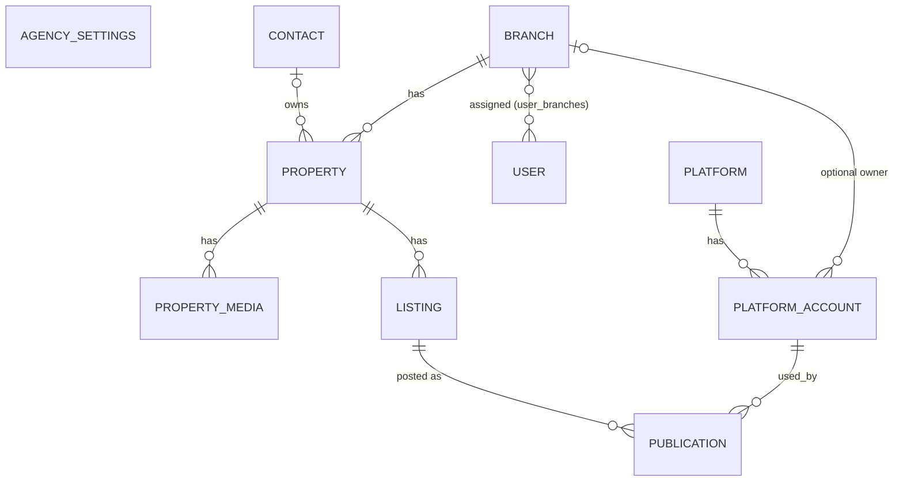

# Database

PostgreSQL 16, TypeORM. IDs are UUIDs. All tables have createdAt, updatedAt and
deletedAt (soft delete) from BaseEntity unless noted.

## Core model

Property (physical asset) → Listing (a sale or rent offer) → Publication (that
listing on one platform account). Never put price or operation on Property.

## Shared pieces

- `Address` (embedded class, used by Branch and Property): street, number, floor,
  unit, neighborhood, city, province, postalCode, lat, lng.
- `bigintToNumber` transformer for all money columns (pg returns bigint as string).

## Tables

### agency_settings (singleton)
Exactly one row (`singleton` boolean, unique + check = true). Seeded on install.
name, legalName, taxId, logoKey, logoDarkKey, faviconKey, primaryColor,
secondaryColor, accentColor, email, phone, whatsapp, website, socials (jsonb),
defaultCurrency (default ARS), timezone (default America/Argentina/Buenos_Aires),
listingFooter (text appended to generated captions/ads).

### branches
code (unique, e.g. "CEN"), name, address (embedded), phone, email, whatsapp,
openingHours (jsonb), isMain (partial unique index: only one main branch),
isActive. Seeded with one main branch on install.

### users
email (unique), passwordHash, name, isActive. ManyToMany branches via `user_branches`. Admins see all branches;
agents only their assigned ones. (Auth design is pending.)

### contacts
firstName, lastName, companyName?, email?, phone?, whatsapp?, taxId?, roles
(varchar[]: `owner` | `lead` | `tenant`; one person can have several), notes.
Agency-wide, not tied to a branch.

### properties
code (unique, generated: branch code + sequence, e.g. "CEN-0042"; never changes
if the property later moves branch), type (`apartment` | `house` | `ph` | `land` |
`office` | `commercial` | `garage`), branchId, ownerId (nullable for now),
address (embedded), hideExactAddress, coveredArea, totalArea, rooms, bedrooms,
bathrooms, garages, ageYears, amenities (jsonb string[]), description,
internalNotes.
Indexes: (branchId), (city, neighborhood), (type).

### property_media
propertyId, storageKey, type (`photo` | `video` | `floorplan`), mimeType,
sizeBytes, sortOrder, isCover (partial unique index: one cover per property).

### listings
propertyId, operation (`sale` | `rent`), status (`draft` | `active` | `paused` |
`closed`), price (bigint), currency (`ARS` | `USD`), expenses (bigint, nullable),
expensesCurrency (default ARS), titleOverride, descriptionOverride,
closedReason (`sold` | `rented` | `withdrawn`), closedAt.
Constraint: partial unique index on (propertyId, operation) where status is
draft/active/paused and not deleted: at most one open listing per operation.
Indexes: (status, operation), (price).
A property can have both a sale and a rent listing at once.

### platforms (catalog, seeded)
code (unique: instagram, argenprop, inmobusqueda, mercadolibre), name,
type (`portal` | `social`), supportedModes (varchar[]: `api` | `feed` | `manual`).

### platform_accounts
platformId, branchId (nullable: null = shared by the whole agency), displayName,
credentials (encrypted jsonb, nullable), isActive.
Unique (platformId, branchId).

### publications
listingId, platformAccountId, status (`pending` | `published` | `failed` |
`removed`), mode (`api` | `feed` | `manual`, default manual), externalId,
externalUrl, lastSyncedAt, lastError.
Unique (listingId, platformAccountId).
